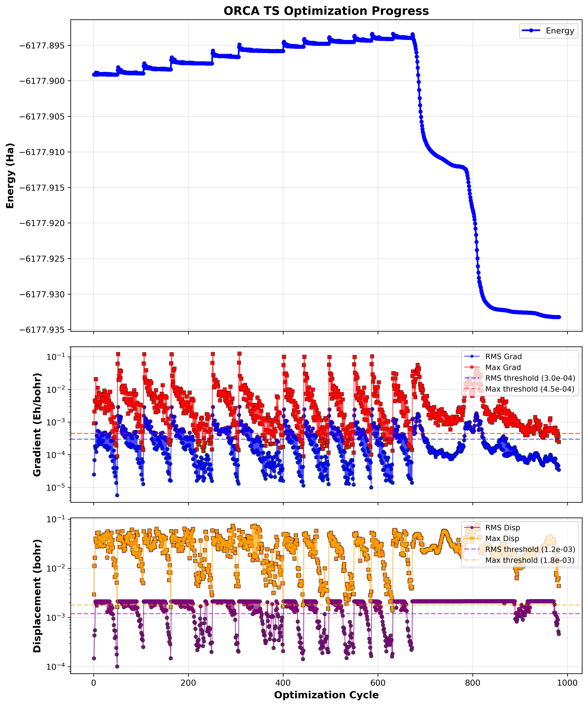

import ScanPath from "../../components/ScanPath.astro";

I recently uploaded a set of utilities that combine the **AIQM2** machine-learning potential with established quantum chemistry tools. The aim is to simplify geometry refinement and transition-state location in complex systems.
Oficial implementations are available in [MLatom](https://github.com/dralgroup/mlatom) (ASE, geomeTRIC and Gaussian), but as for the date I am writting this, the oficial implementations lacked the possibility of adding positional and distance restraints during TS search and SCAN. Also, I like the TS search algorithm from Sella, and the ability of using the analytical hessian for the TS search. (I tried to implement this on ORCA, but I failed to use the computed hessian for the TS search)

* **ORCA Opt and SCAN minimization** – a workflow that drives geometry relaxation by coupling AIQM2 calculator with ORCA's Opt and SCAN algorithms. [Implementation on GitHub](https://github.com/miqueleg/MLatom-ORCA-interface)
* **Sella transition state search** – harnesses the Sella optimizer for efficient saddle-point searches using AIQM2 energies, gradients and hessian. [Implementation on GitHub](https://github.com/miqueleg/MLatom-Sella-TS-search)

### SCAN example

Below is a SCAN-driven optimization example. The plot shows the energy evolution over optimization cycles.

#### Interactive trajectory

The same scan, frame by frame. Click or drag along the energy profile to move through it.

<ScanPath />

[Download the trajectory (xyz, 2.8 MB)](/assets/xyz/output_traj_reduced.xyz)
